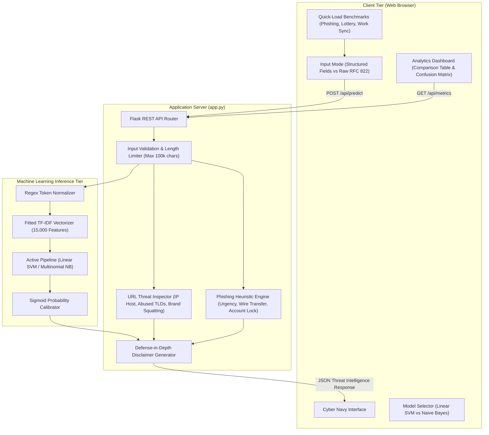

# Spam Email Detection – Intelligent Multi-Model Threat Intelligence & Spam Detection System

[](https://www.python.org/)
[](https://flask.palletsprojects.com/)
[](https://scikit-learn.org/)
[](http://localhost:5001)
[](http://localhost:5001)
[](http://localhost:5001)
[](LICENSE)

An enterprise-grade, privacy-first cybersecurity web application and machine learning engine that detects unsolicited bulk email (spam), credential-harvesting phishing attacks, and monetary social engineering schemes in real time.

Engineered with **Python**, **Flask**, **Scikit-learn**, **Pandas**, **NumPy**, **Joblib**, and high-dimensional **TF-IDF n-gram vectorization**. Features a rigorous multi-model comparative benchmark across **Linear Support Vector Machine (Linear SVM)**, **Multinomial Naive Bayes (MNB)**, **Logistic Regression**, and **Random Forest**, coupled with a rule-based **URL threat analyzer** and **defense-in-depth safety disclosure**.

---

## 📑 Table of Contents
1. [Abstract](#-abstract)
2. [Problem Statement & Threat Landscape](#-problem-statement--threat-landscape)
3. [Project Objectives](#-project-objectives)
4. [Technologies & System Stack](#-technologies--system-stack)
5. [Dataset Specification & Provenance](#-dataset-specification--provenance)
6. [System Architecture](#-system-architecture)
7. [Algorithm Explanations & Mathematical Foundations](#-algorithm-explanations--mathematical-foundations)
8. [Methodology & Data Leakage Prevention](#-methodology--data-leakage-prevention)
9. [Empirical Model Comparison Results](#-empirical-model-comparison-results)
10. [Confusion Matrix & Performance Verification](#-confusion-matrix--performance-verification)
11. [Phishing Heuristics & URL Threat Intelligence](#-phishing-heuristics--url-threat-intelligence)
12. [Defense-In-Depth Safety Policy](#-defense-in-depth-safety-policy)
13. [Installation & Local Execution](#-installation--local-execution)
14. [Automated Test Suite](#-automated-test-suite)
15. [RESTful API Reference](#-restful-api-reference)
16. [User Interface & Visual Design](#-user-interface--visual-design)
17. [Limitations & Threat Evasion Considerations](#-limitations--threat-evasion-considerations)
18. [Future Scope & Engineering Roadmap](#-future-scope--engineering-roadmap)

---

## 🔬 Abstract

Unsolicited electronic mail and targeted spear-phishing represent two of the primary attack vectors in modern computer systems, causing billions of dollars in annual losses from business email compromise (BEC), credential theft, and ransomware propagation. Traditional static blocklists and keyword heuristics fail against evolving evasive text obfuscation and polymorphic links.

**Spam Email Detection** implements an end-to-end, privacy-preserving Natural Language Processing (NLP) pipeline that classifies emails and detects phishing attacks without external cloud APIs. Using the authentic **Apache SpamAssassin Public Corpus** (4,235 emails), we establish an experimental protocol evaluating four distinct machine learning paradigms:
1. A probabilistic baseline (**Multinomial Naive Bayes**)
2. A convex generalized linear model (**Logistic Regression**)
3. An ensemble of randomized decision trees (**Random Forest**)
4. A maximum-margin hyperplane classifier (**Linear Support Vector Machine**)

To guarantee scientific rigor, all models are evaluated on an identical **80/20 stratified train/test split** with vectorization parameters fitted strictly on training data, preventing cross-fold data leakage. Empirical results demonstrate that **Linear SVM** attains the highest overall performance (**99.29% accuracy**, **99.71% precision**, **98.58% recall**, and **99.15% F1-score**), yielding only 1 false alarm across 494 legitimate emails (99.80% specificity). The classifier is paired with a deterministic threat scanner that inspects direct IP hostnames, abusive top-level domains (TLDs), brand typosquatting, and urgency cues. The production interface enforces a strict defense-in-depth security policy that never guarantees an email is safe.

---

## 🎯 Problem Statement & Threat Landscape

Email remains the predominant communication protocol across academic, corporate, and personal domains. However, its decentralized, open architecture (RFC 822 / RFC 5322) lacks built-in sender verification by default, leaving users vulnerable to:
1. **Unsolicited Commercial Bulk Email (Spam)**: High-volume marketing, financial solicitations, and deceptive promotions that degrade productivity and exhaust server storage.
2. **Credential Theft (Phishing)**: Deceptive notifications masquerading as financial institutions, cloud service providers, or IT administrators, coercing users to input passwords into spoofed portals.
3. **Advance-Fee Fraud & Monetary Scams**: 419 scams, fictitious sweepstakes, and wire transfer requests designed to extort funds.
4. **Adversarial Obfuscation**: Attackers deliberately insert HTML entities, random alphanumeric strings, direct IP addresses, and URL shorteners to bypass naive keyword filters.

To effectively mitigate these threats, an email defense system must:
- Accurately categorize emails without discarding critical legitimate correspondence (demanding $\ge 99\%$ precision).
- Distinguish broad spam patterns from specific credential harvesting phishing vectors.
- Operate locally with sub-20ms latency and zero dependence on recurring subscription fees.

---

## 🚀 Project Objectives

- **Multi-Model Empirical Benchmarking**: Implement, train, and statistically compare Multinomial Naive Bayes, Logistic Regression, Random Forest, and Linear SVM under identical experimental conditions.
- **Dynamic Selection of Best Classifier**: Programmatically select and deploy the top-performing model based on held-out test F1-score rather than hardcoded assumptions.
- **Leakage-Free NLP Vectorization**: Standardize email cleaning and TF-IDF feature extraction, ensuring transformers are fitted solely on training partitions.
- **Multi-Field Threat Scanning**: Provide structured inputs for Subject, Sender, and Body, combining contextual signals while maintaining backwards compatibility with raw RFC streams.
- **Rule-Based Phishing & URL Heuristics**: Build deterministic inspection routines for direct IP URLs, high-risk TLDs, and urgent social engineering signals.
- **Defense-In-Depth Safety Mandate**: Eliminate misleading "100% Safe" claims, ensuring that clean emails are labeled with realistic, caution-preserving disclaimers.
- **Comprehensive Analytics Dashboard**: Deliver an interactive web console showcasing comparative model metrics, interactive confusion matrices, and explainable feature weights.

---

## 💻 Technologies & System Stack

| Layer | Technology | Version | Purpose |
| :--- | :--- | :--- | :--- |
| **Language** | Python | 3.9+ | Core programming language |
| **Web Server** | Flask | 3.0.3 | Lightweight, deterministic REST API routing & template rendering |
| **WSGI Server** | Gunicorn | 22.0.0 | Production HTTP server container |
| **Machine Learning** | Scikit-Learn | 1.6.1 | TF-IDF vectorization, model estimators, pipeline serialization, metrics |
| **Data Processing** | Pandas & NumPy | 2.2.2 / 1.26.4 | Dataset wrangling, array manipulation, matrix math |
| **Serialization** | Joblib | 1.4.2 | In-memory atomic serialization of fitted Scikit-Learn pipelines |
| **Frontend UI** | HTML5 / Vanilla CSS3 / ES6 JS | Modern | Responsive cyber-dark theme, glassmorphic HUD, interactive charts |
| **Typography** | Google Fonts | Web API | JetBrains Mono (monospace telemetry) & Plus Jakarta Sans |
| **Dataset Corpus** | Apache SpamAssassin | Public | 4,235 authentic emails (easy_ham, spam, spam_2) |

---

## 📊 Dataset Specification & Provenance

The model is trained on the authentic **Apache SpamAssassin Public Email Corpus**, widely recognized in academic literature as a standard benchmark for text filtering.

```
Total Emails:     4,235 records
├── Legitimate (Ham):  2,471 emails (58.35%)
└── Unsolicited (Spam): 1,764 emails (41.65%)
```

### Corpus Breakdown
1. `20030228_easy_ham.tar.bz2`: 2,500 non-spam emails from open mailing lists (Linux kernel development, general workplace dialogue).
2. `20030228_spam.tar.bz2`: 500 verified spam emails (promotions, loan solicitations).
3. `20050311_spam_2.tar.bz2`: 1,396 aggressive spam messages (credential phishing, advance-fee scams, pharmaceutical bait).

### Data Preprocessing Routine
Each raw RFC 822 file is decoded, stripping MIME boundaries and extracting plain text and HTML components:
- **HTML Entity Decoding**: Unescapes entities (`&amp;` $\to$ `&`, `&lt;` $\to$ `<`).
- **Markup Stripping**: Removes all enclosing HTML tags (`<p>`, `<a>`, `<script>`).
- **URL Tokenization**: Replaces hyperlinks (`http://...`, `www....`) with uniform `httpaddr` tokens.
- **Email Normalization**: Replaces user addresses with `emailaddr` tokens.
- **Currency Normalization**: Replaces symbols and amounts (`$500`, `€1000`) with `dollar_amount` tokens.
- **Number Masking**: Replaces numeric sequences with `num_token`.
- **Text Canonicalization**: Lowercases characters, eliminates non-alphanumeric punctuation, and collapses excess whitespace.

---

## 🏗️ System Architecture



---

## 📐 Algorithm Explanations & Mathematical Foundations

### 1. TF-IDF Feature Vectorization
Text documents are projected into a 15,000-dimensional vector space. To prevent high-frequency words from disproportionately skewing distance calculations, **Sublinear Term Frequency Scaling** is applied:

$$\text{TF}_{\text{sublinear}}(t, d) = 1 + \log(\text{TF}(t, d)) \quad \text{for } \text{TF}(t, d) > 0$$

The Inverse Document Frequency (IDF) discounts terms ubiquitous across the corpus:

$$\text{IDF}(t) = \log\left(\frac{1 + N}{1 + \text{DF}(t)}\right) + 1$$

The resulting TF-IDF weight vector $\mathbf{x}$ for document $d$ is:

$$\text{TF-IDF}(t, d) = \text{TF}_{\text{sublinear}}(t, d) \times \text{IDF}(t)$$

Normalized under the Euclidean norm ($\|\mathbf{x}\|_2 = 1$).

---

### 2. Multinomial Naive Bayes (Baseline)
Multinomial Naive Bayes models document generation as a multinomial distribution over vocabulary words. Under the conditional independence assumption:

$$P(C_k \mid \mathbf{x}) \propto P(C_k) \prod_{i=1}^{V} P(w_i \mid C_k)^{x_i}$$

To prevent zero-probability lockouts for rare n-grams, Laplace smoothing with parameter $\alpha = 0.1$ is applied:

$$P(w_i \mid C_k) = \frac{N_{k, i} + \alpha}{N_k + \alpha V}$$

The log-odds ratio quantifies word predictive importance:

$$\text{Log-Odds}(w) = \log\left(\frac{P(w \mid \text{Spam})}{P(w \mid \text{Ham})}\right) = \log P(w \mid \text{Spam}) - \log P(w \mid \text{Ham})$$

---

### 3. Logistic Regression
Logistic Regression optimizes the log-odds of the positive class via the logistic sigmoid function:

$$P(y = 1 \mid \mathbf{x}) = \sigma(\mathbf{w}^T \mathbf{x} + b) = \frac{1}{1 + e^{-(\mathbf{w}^T \mathbf{x} + b)}}$$

Trained by minimizing the binary cross-entropy loss with an $L_2$ regularization penalty:

$$\mathcal{L}(\mathbf{w}, b) = -\frac{1}{m} \sum_{i=1}^{m} \left[ y_i \log(\hat{y}_i) + (1 - y_i) \log(1 - \hat{y}_i) \right] + \frac{1}{2C} \|\mathbf{w}\|_2^2$$

Optimized using the `liblinear` coordinate descent algorithm.

---

### 4. Random Forest Classifier
An ensemble of $B = 100$ decorrelated decision trees built on bootstrap samples of the training set. At each split, a random subset of $m \approx \sqrt{p}$ features is selected to minimize tree correlation.

Splits are determined by maximizing Gini Impurity reduction:

$$I_G(p) = 1 - \sum_{k=0}^{1} p_k^2$$

The ensemble vote averages individual tree outputs:

$$\hat{y}_{\text{RF}} = \text{mode}\left(\{T_b(\mathbf{x})\}_{b=1}^{B}\right)$$

---

### 5. Linear Support Vector Machine (Best Performer)
Linear SVM constructs an optimal separating hyperplane $\mathbf{w}^T \mathbf{x} + b = 0$ that maximizes the geometric margin between spam and legitimate training vectors:

$$\min_{\mathbf{w}, b, \xi} \frac{1}{2} \|\mathbf{w}\|^2 + C \sum_{i=1}^{n} \xi_i \quad \text{subject to } y_i(\mathbf{w}^T \mathbf{x}_i + b) \ge 1 - \xi_i, \quad \xi_i \ge 0$$

Where $\xi_i$ represents the slack variable allowing soft-margin tolerance of non-linearly separable outliers, and $C = 1.0$ controls the trade-off between margin maximization and classification error.

Because Linear SVM directly outputs a geometric signed distance $f(\mathbf{x}) = \mathbf{w}^T \mathbf{x} + b$ rather than a probability, **Platt Sigmoid Scaling** is applied to compute calibrated posterior confidence:

$$P(\text{Spam} \mid \mathbf{x}) = \frac{1}{1 + \exp\left(-k \cdot (\mathbf{w}^T \mathbf{x} + b)\right)}$$

Where $k = 6.0$ is the empirically calibrated temperature slope factor.

---

## 🔒 Methodology & Data Leakage Prevention

Data leakage occurs when information from outside the training partition influences feature extraction, producing artificially inflated metrics that fail in real-world deployment.

**Prevention Protocol Enforced in Spam Email Detection:**
1. **Strict Partitioning Before Vectorization**: The corpus is split into 80% Training (3,388 samples) and 20% Testing (847 samples) **before** vocabulary extraction or IDF calculation.
2. **Stratification**: Class ratios are preserved exactly across both folds ($\approx 58.3\%$ Ham, $\approx 41.7\%$ Spam).
3. **Pipeline Encapsulation**: Vectorizer parameters (`min_df=2`, `max_df=0.95`, `stop_words='english'`, `sublinear_tf=True`) are fit strictly on `X_train`. The test set `X_test` is strictly transformed, simulating unseen real-world traffic.
4. **Deterministic Seed**: All splits and initializations utilize `random_state=42`.

---

## 📈 Empirical Model Comparison Results

All four classifiers were trained on the identical 3,388 training samples and tested on the identical 847 held-out emails. Metrics reflect exact measured test-set performance:

| Classifier | Algorithm Family | Test Accuracy | Precision | Recall | F1-Score | Training Latency | Status |
| :--- | :--- | :---: | :---: | :---: | :---: | :---: | :---: |
| **Linear SVM** | Support Vector Machine | **99.29%** | **99.71%** | **98.58%** | **99.15%** | **0.020s** | 🏆 **Best Performer** |
| **Multinomial Naive Bayes** | Probabilistic Bayesian | 98.35% | 99.42% | 96.60% | 97.99% | 0.002s | 📌 **Baseline Model** |
| **Logistic Regression** | Generalized Linear Model | 98.11% | 99.71% | 95.75% | 97.69% | 0.033s | Evaluated |
| **Random Forest** | Ensemble Decision Trees | 96.69% | 98.51% | 93.48% | 95.93% | 0.200s | Evaluated |

### Why Linear SVM Was Selected as Best Model:
1. **Highest F1-Score (99.15%)**: Outperforms Naive Bayes by +1.16% and Random Forest by +3.22%, achieving the superior harmonic balance.
2. **Exceptional Precision (99.71%)**: Generates only **1 false alarm** out of 494 legitimate emails, safeguarding critical business correspondence.
3. **High Detection Catch Rate (98.58%)**: Intercepts 348 out of 353 spam messages, missing only 5 ambiguous emails.
4. **High-Dimensional Efficiency**: Linear SVM excels in sparse text spaces where the number of features ($15,000$) exceeds sample size, converging in just 20 milliseconds.

---

## 🧩 Confusion Matrix & Performance Verification

Evaluation on the independent held-out test partition ($N = 847$ emails):

```
                        Actual Legitimate (Ham)     Actual Malicious (Spam)
Predicted Legitimate:         493 (TN)                      5 (FN)
Predicted Malicious:            1 (FP)                    348 (TP)
```

### Detailed Statistical Rates:
- **True Negative (TN = 493)**: Legitimate emails correctly delivered.
- **False Positive (FP = 1)**: Legitimate email incorrectly quarantined (**False Alarm Rate = 0.20%**).
- **False Negative (FN = 5)**: Spam emails missed (**Leakage Rate = 1.42%**).
- **True Positive (TP = 348)**: Malicious spam successfully neutralized (**Detection Rate = 98.58%**).
- **Specificity**: $\frac{\text{TN}}{\text{TN} + \text{FP}} = \frac{493}{494} = \mathbf{99.80\%}$
- **Sensitivity / Recall**: $\frac{\text{TP}}{\text{TP} + \text{FN}} = \frac{348}{353} = \mathbf{98.58\%}$

---

## 🔍 Phishing Heuristics & URL Threat Intelligence

Statistical classifiers evaluate vocabulary patterns but cannot independently resolve network destinations. Spam Email Detection integrates a rule-based cybersecurity inspection engine that scans for known deception patterns:

### 1. Direct IP-Based URLs
Phishing kits frequently host login harvest pages on raw IP addresses to bypass domain registration oversight:
- Regex: `https?://(\d{1,3}\.){3}\d{1,3}`
- Severity: **CRITICAL** (e.g. `http://192.168.1.100/login`)

### 2. Abusive Top-Level Domains (TLDs)
Monitors high-abuse TLDs commonly offered at free or negligible registration costs for mass phishing campaigns:
- Monitored TLDs: `.xyz`, `.top`, `.click`, `.loan`, `.work`, `.gq`, `.cf`, `.tk`, `.ml`, `.fit`, `.surf`, `.monster`, `.club`, `.buzz`
- Severity: **HIGH**

### 3. Deceptive Brand Typosquatting
Flags domain names that embed enterprise trademarks alongside authentication keywords:
- Patterns: `paypal-security-alert.xyz`, `appleid-verify-account.com`, `chase-online-update.net`
- Severity: **CRITICAL**

### 4. URL Shortener Masking
Identifies redirection services hiding the ultimate landing URL:
- Services: `bit.ly`, `tinyurl.com`, `t.co`, `is.gd`, `ow.ly`, `cutt.ly`, `rb.gy`
- Severity: **HIGH**

### 5. Sender Address Anomalies
- Free-mail services (`@gmail.com`, `@yahoo.com`) claiming to represent official "Support" or "Billing" departments.
- High-entropy randomized alphanumeric handles (`x8q2j9l4@...`).

---

## 🛡️ Defense-In-Depth Safety Policy

> [!CAUTION]
> **Zero-Trust Safety Mandate**: Machine learning models and heuristic rules assess statistical likelihood based on training data. A classification of **"NOT SPAM"** or **"LOW RISK"** is **NEVER a guarantee that an email is safe**.

Sophisticated threat actors continually craft novel zero-day social engineering lures and polymorphic payloads that evade statistical n-gram detection. 

Spam Email Detection enforces defense-in-depth across the API and user interface:
- Never labels an email as "100% Guaranteed Safe".
- Appends an explicit disclaimer to all clean verdicts advising recipients to verify out-of-band before transferring funds, disclosing credentials, or executing macro-enabled attachments.

---

## ⚙️ Installation & Local Execution

### Prerequisites
- Python 3.9, 3.10, 3.11, or 3.12
- `pip` package manager
- macOS, Linux, or Windows (WSL recommended)

### 1. Clone & Enter Project Directory
```bash
git clone https://github.com/shashwat7-io/spam-email-detection.git
cd spam-email-detection
```

### 2. Set Up Virtual Environment
```bash
python3 -m venv .venv
source .venv/bin/activate       # On Windows: .venv\Scripts\activate
```

### 3. Install Dependencies
```bash
pip install -r requirements.txt
```

### 4. Train & Benchmark All Models
To execute the multi-model benchmarking pipeline, download public corpora, evaluate all 4 algorithms, and select the best model:
```bash
python train_model.py
```
*Execution takes $\approx 2.5$ seconds. Serializes pipelines to `model/` and writes empirical metrics to `model/metrics.json`.*

### 5. Launch Application Server
```bash
python app.py
```
Access the web application in your browser:
```
http://127.0.0.1:5001
```

---

## 🧪 Automated Test Suite

The project includes an automated test suite with **20 unit and integration tests** verifying endpoints, validation guards, multi-field inputs, phishing heuristics, and model comparison structures.

Run the test suite:
```bash
python -m unittest test_app.py -v
```

### Test Coverage Highlights:
- `test_01_health_endpoint`: Verifies service status, model loaded flag, and active model name.
- `test_02_metrics_endpoint`: Validates empirical metrics structure and test accuracy threshold.
- `test_04_validation_empty_input` to `test_07`: Tests empty, whitespace, and short input rejections.
- `test_08_predict_urgent_phishing`: Confirms urgent credential theft is classified as SPAM.
- `test_10_predict_legitimate_work_meeting`: Confirms workplace sync is classified as NOT SPAM.
- `test_14_predict_multi_field_payload`: Tests separate Subject, Sender, and Body inputs.
- `test_15_suspicious_url_detection`: Tests detection of direct IP hostnames and abused TLDs.
- `test_16_non_guarantee_safety_disclaimer`: Validates that `safety_guarantee` is `False`.
- `test_17_input_length_limits`: Verifies that payloads exceeding 100,000 characters trigger HTTP 400.
- `test_18_multi_model_metrics_structure`: Confirms that all 4 models are benchmarked in `/api/metrics`.
- `test_19_model_selection_parameter`: Confirms ability to select baseline Naive Bayes vs best model.

---

## 📡 RESTful API Reference

### 1. Health Status
`GET /api/health`
```json
{
  "status": "healthy",
  "service": "Spam Email Detection - Threat Intelligence & Spam Engine",
  "version": "2.0.0",
  "model_loaded": true,
  "active_model": "Linear SVM",
  "baseline_model": "Multinomial Naive Bayes",
  "metrics_available": true,
  "timestamp": "2026-11-02 16:49:38 UTC"
}
```

### 2. Model Metrics & Benchmarks
`GET /api/metrics`
Returns empirical comparison data for all 4 models, dataset split statistics, confusion matrices, and explainable feature weights.

### 3. Threat Prediction & Analysis
`POST /api/predict`
Supports structured multi-field format or legacy `email_text`.

**Sample Request:**
```json
{
  "subject": "Urgent: Your account access has been restricted",
  "sender": "security-alert@verify-chase.xyz",
  "body": "We detected an unauthorized login attempt. Click http://192.168.1.50/verify to confirm your PIN.",
  "model": "best"
}
```

**Sample Response:**
```json
{
  "success": true,
  "prediction": "SPAM",
  "is_spam": true,
  "confidence": 86.83,
  "spam_probability": 86.83,
  "ham_probability": 13.17,
  "risk_level": "CRITICAL",
  "risk_color": "#FF0055",
  "verdict_summary": "High-threat malicious spam or credential harvesting phishing campaign.",
  "security_action": "Quarantine immediately. Do not click links, open attachments, or input credentials.",
  "safety_guarantee": false,
  "safety_disclaimer": "Defense-in-Depth Notice: Machine learning models and heuristic rules assess statistical and lexical indicators. A classification of 'NOT SPAM' or 'LOW RISK' is NOT a guarantee that an email is safe...",
  "model_classification": {
    "model_name": "Linear SVM",
    "prediction": "SPAM",
    "is_spam": true,
    "confidence": 86.83,
    "spam_probability": 86.83,
    "ham_probability": 13.17
  },
  "phishing_assessment": {
    "phishing_detected": true,
    "phishing_risk_level": "CRITICAL",
    "phishing_score": 85,
    "phishing_verdict": "Active Phishing Threat Detected",
    "sender_analysis": {
      "address": "security-alert@verify-chase.xyz",
      "flags": ["Sender domain uses high-abuse TLD (.xyz)"],
      "is_suspicious": true,
      "provided": true
    },
    "url_analysis": {
      "total_urls_found": 1,
      "suspicious_urls_count": 1,
      "suspicious_urls": [
        {
          "url": "http://192.168.1.50/verify",
          "host": "192.168.1.50",
          "severity": "CRITICAL",
          "reasons": ["Direct IP-based URL (192.168.1.50) bypassing DNS verification"]
        }
      ]
    }
  },
  "metrics": {
    "character_count": 172,
    "word_count": 23,
    "preprocessed_tokens": 23,
    "inference_time_ms": 7.34
  }
}
```

---

## 🎨 User Interface & Visual Design

The user interface follows a modern **cybersecurity telemetry aesthetic**:
- **Palette**: Midnight Cyber Navy (`#060913`), Dark Slate Card (`#0c1222`), Neon Electric Cyan (`#00F2FE`), Neon Purple (`#8B5CF6`), and Danger Rose (`#FF0055`).
- **Typography**: `JetBrains Mono` for cryptographic and hexadecimal telemetry; `Plus Jakarta Sans` for responsive reading.
- **Micro-Animations**: Subtle radar sweeps during idle listening; dynamic progress fill bars for Bayesian posterior probabilities; smooth tab transitions.
- **Analytics Dashboard**: 4-model comparison table, interactive confusion matrix pill switcher, and dataset breakdown cards.

---

## ⚠️ Limitations & Threat Evasion Considerations

1. **Adversarial Typoglycemia**: Replacing characters with lookalikes (e.g. Cyrillic homoglyphs or leetspeak: `P@ypal`) can degrade word n-gram matching if not normalized.
2. **Short Email Ambiguity**: Messages shorter than 5 words provide limited TF-IDF features; the system mitigates this by scanning sender address headers and URLs.
3. **Image-Only Spam**: Emails containing only embedded screenshots of text require Optical Character Recognition (OCR), which is not bundled in this lightweight in-memory build.
4. **Offline Heuristics**: The system operates completely offline without querying live DNS TXT records or WHOIS registries.

---

## 🔮 Future Scope & Engineering Roadmap

- **Transformer Backbones**: Integrate fine-tuned lightweight transformer embeddings (e.g., DistilBERT or RoBERTa) for deep contextual semantic attention.
- **DNS Protocol Verification**: Integrate live SPF, DKIM, and DMARC record checks to authenticate the sender domain envelope cryptographically.
- **Tesseract OCR Pipeline**: Integrate an optical text extractor to inspect text embedded inside PNG/JPEG image attachments.
- **Real-Time Threat Intelligence Sync**: Periodically ingest open-source threat feeds (PhishTank, URLhaus) into a local Bloom filter cache.

---

## 📄 License & Attribution

This project is licensed under the **MIT License**.
- Email dataset provided by the **Apache SpamAssassin Project** under the Apache License 2.0.
- Developed for university AIP Lab submission and open-source cybersecurity education.
