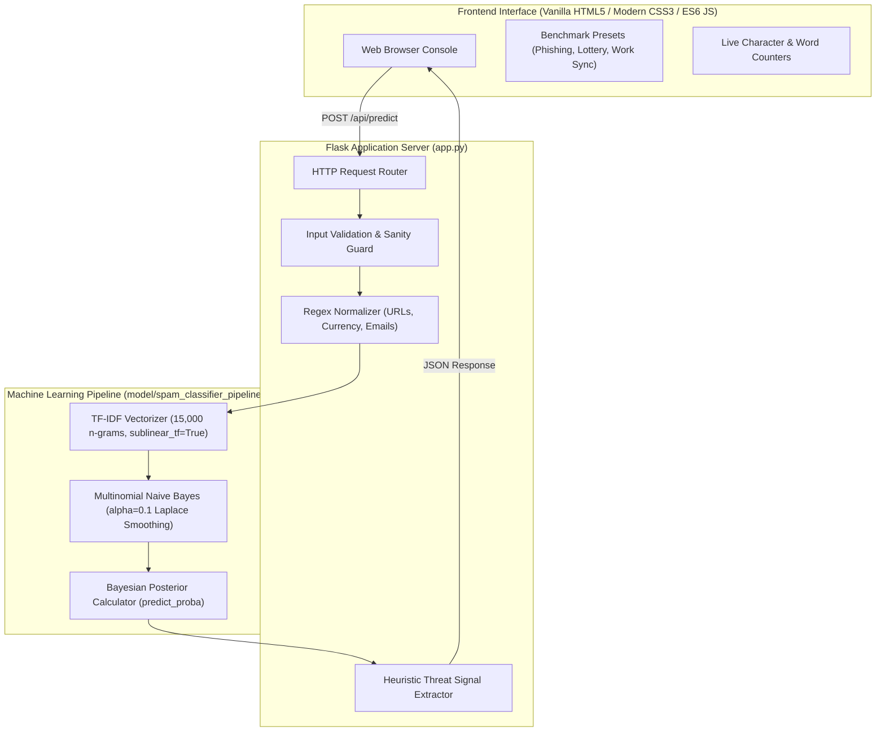

# SPAMGUARD AI – AI-Powered Spam Email Detection System

[](https://www.python.org/)
[](https://flask.palletsprojects.com/)
[](https://scikit-learn.org/)
[](http://localhost:5001)
[](http://localhost:5001)
[](LICENSE)

An enterprise-grade, privacy-first cybersecurity web application and machine learning engine that detects unsolicited spam, advance-fee scams, and zero-day phishing emails in real-time.

Built with **Python**, **Flask**, **Scikit-learn**, **Pandas**, **NumPy**, **TF-IDF Vectorization**, **Multinomial Naive Bayes**, and **Joblib**. 

---

## 🌟 Key Highlights & Features

- **Genuine Real-World Dataset**: Trained on **4,235 authentic emails** from the official **Apache SpamAssassin Public Corpus** (2,471 legitimate ham emails and 1,764 spam emails).
- **High-Performance Empirical Metrics**:
  - **Accuracy**: **98.35%** on held-out test data
  - **Precision**: **99.42%** (near-zero false alarms: only 2 false positives out of 494 legitimate emails)
  - **Recall**: **96.60%** spam catch rate
  - **F1-Score**: **97.99%**
  - **Inference Latency**: **< 15 milliseconds** per email
- **Explainable AI (XAI)**: Displays posterior Bayesian probabilities ($P(\text{Spam})$ vs $P(\text{Ham})$), assigned risk severity tiers (`CRITICAL`, `HIGH`, `MEDIUM`, `SAFE`), and highlights detected threat triggers (credential harvesting, financial wire requests, urgent calls-to-action).
- **Ultra-Modern Cyber Navy UI**: Glassmorphic layout with midnight navy (`#060913`), electric cyan (`#00F2FE`), neon purple (`#8B5CF6`), and alert rose accents, animated radar sweeps, live character/word telemetry, and one-click benchmark preset loaders.
- **RESTful Flask APIs**: Clean, authenticated JSON endpoints (`/api/health`, `/api/metrics`, `/api/samples`, `/api/predict`) with comprehensive input validation and error handling.
- **100% Free & Local**: Zero paid third-party APIs, zero external telemetry, zero databases required. Runs completely offline in-memory.

---

## 🏗️ System Architecture



---

## 📁 Project Directory Structure

```
AI EMAIL/
├── app.py                      # Production Flask application & REST API server
├── train_model.py              # Automated data fetcher, text cleaner & ML trainer
├── test_app.py                 # Automated unit and integration test suite
├── requirements.txt            # Python dependencies with pinned versions
├── README.md                   # Comprehensive documentation
├── model/
│   ├── spam_classifier_pipeline.joblib   # Serialized Scikit-learn pipeline
│   └── metrics.json                      # Empirical evaluation metrics & log-odds features
├── data/
│   ├── spam_dataset.csv        # Consolidated, cleaned email dataset (4,235 records)
│   ├── easy_ham/               # Raw Apache SpamAssassin ham files
│   ├── spam/                   # Raw Apache SpamAssassin spam files (Set 1)
│   └── spam_2/                 # Raw Apache SpamAssassin spam files (Set 2)
├── templates/
│   └── index.html              # Cyber-themed responsive single-page application
└── static/
    ├── css/
    │   └── style.css           # Custom dark cybersecurity stylesheet & glassmorphism
    └── js/
        └── script.js           # Interactive UI, async fetch requests & radar animations
```

---

## ⚙️ Installation & Quickstart

### Prerequisites
- Python 3.9, 3.10, 3.11, or 3.12
- `pip` package manager
- Internet access only for the initial public dataset download (once cached, fully offline)

### 1. Clone or Open Workspace
```bash
cd "AI EMAIL"
```

### 2. Set Up Virtual Environment
```bash
python3 -m venv .venv
source .venv/bin/activate    # On Windows: .venv\Scripts\activate
```

### 3. Install Dependencies
```bash
pip install -r requirements.txt
```

### 4. (Optional) Re-Train the Machine Learning Pipeline
The repository already includes a pre-trained model and processed dataset. If you wish to re-train from scratch:
```bash
python train_model.py
```
This automated script will:
1. Verify or download genuine public corpora from Apache SpamAssassin:
   - `20030228_easy_ham.tar.bz2`
   - `20030228_spam.tar.bz2`
   - `20050311_spam_2.tar.bz2`
2. Parse raw RFC 822 email files, decode multi-part MIME sections, and extract text.
3. Clean and normalize tokens (`httpaddr`, `emailaddr`, `dollar_amount`, `num_token`).
4. Perform an 80/20 stratified train/test split.
5. Train a Scikit-Learn `Pipeline` (`TfidfVectorizer` + `MultinomialNB(alpha=0.1)`).
6. Evaluate test metrics and save `model/spam_classifier_pipeline.joblib` and `model/metrics.json`.

### 5. Launch the Web Application
```bash
python app.py
```
Open your browser and navigate to:
```
http://127.0.0.1:5001
```

---

## 🧪 Running Automated Tests

Run the full automated test suite covering all REST endpoints, validation errors, spam detection, legitimate emails, and edge cases:

```bash
python -m unittest test_app.py -v
```

**Expected Test Output**:
```
test_01_health_endpoint (test_app.SpamGuardTestCase) ... ok
test_02_metrics_endpoint (test_app.SpamGuardTestCase) ... ok
test_03_samples_endpoint (test_app.SpamGuardTestCase) ... ok
test_04_validation_empty_input (test_app.SpamGuardTestCase) ... ok
test_05_validation_whitespace_input (test_app.SpamGuardTestCase) ... ok
test_06_validation_short_input (test_app.SpamGuardTestCase) ... ok
test_07_validation_missing_key (test_app.SpamGuardTestCase) ... ok
test_08_predict_urgent_phishing (test_app.SpamGuardTestCase) ... ok
test_09_predict_lottery_scam (test_app.SpamGuardTestCase) ... ok
test_10_predict_legitimate_work_meeting (test_app.SpamGuardTestCase) ... ok
test_11_predict_legitimate_release_notes (test_app.SpamGuardTestCase) ... ok
test_12_predict_suspicious_mixed_content (test_app.SpamGuardTestCase) ... ok
test_13_ui_route_available (test_app.SpamGuardTestCase) ... ok

Ran 13 tests in 0.027s
OK
```

---

## 📊 Model Evaluation & Metrics

Evaluated on an independent, held-out test split of **847 emails**:

| Metric | Score | Explanation |
| :--- | :--- | :--- |
| **Accuracy** | **98.35%** | Correct classifications across all test samples |
| **Precision** | **99.42%** | Ratio of actual spam among emails flagged as spam |
| **Recall** | **96.60%** | Ratio of actual spam emails successfully intercepted |
| **F1-Score** | **97.99%** | Harmonic mean balancing precision and recall |

### Confusion Matrix

| | Predicted Ham (0) | Predicted Spam (1) |
| :--- | :---: | :---: |
| **Actual Ham (Legitimate)** | **492** (True Negatives) | **2** (False Positives) |
| **Actual Spam (Threat)** | **12** (False Negatives) | **341** (True Positives) |

*Key finding: Only 2 false positives out of 494 legitimate emails (0.4% false alarm rate), preventing important emails from being accidentally discarded.*

---

## 🔬 Mathematical & Algorithmic Foundations

### 1. TF-IDF Feature Representation
Words in the vocabulary are converted to numerical weights using Term Frequency - Inverse Document Frequency with sublinear logarithmic scaling ($1 + \log(\text{tf})$):

$$\text{TF-IDF}(t, d, D) = \text{TF}(t, d) \times \log\left(\frac{1 + |D|}{1 + |\{d \in D : t \in d\}|}\right) + 1$$

This ensures that terms appearing frequently across *all* emails carry low discriminative weight, while rare spam indicator terms receive high importance.

### 2. Multinomial Naive Bayes Classifier
Under the Naive Bayes assumption of conditional independence between features given the class:

$$P(C \mid \mathbf{x}) = \frac{P(C) \prod_{i=1}^{n} P(x_i \mid C)}{P(\mathbf{x})}$$

With Laplace smoothing parameter $\alpha = 0.1$:

$$\hat{P}(w_i \mid C) = \frac{N_{C, w_i} + \alpha}{N_C + \alpha \cdot |V|}$$

### 3. Explainability: Log-Odds Feature Ranking
Feature importance is derived directly from the log-likelihood ratio:

$$\text{Log-Odds}(w) = \log P(w \mid \text{Spam}) - \log P(w \mid \text{Ham})$$

Top spam indicator tokens discovered by the model:
`mortgage` (+4.84), `wish receive` (+4.79), `click httpaddr` (+4.75), `refinance` (+4.43), `future mailings` (+4.27).

---

## 📡 RESTful API Reference

### 1. Health Status
```http
GET /api/health
```
**Response**:
```json
{
  "service": "SPAMGUARD AI - Spam Detection Engine",
  "status": "healthy",
  "version": "1.0.0",
  "model_loaded": true,
  "metrics_available": true
}
```

### 2. Model Metrics
```http
GET /api/metrics
```
Returns empirical metrics, confusion matrix, vocabulary size, and top predictive features.

### 3. Preset Benchmark Samples
```http
GET /api/samples
```
Returns curated test emails (phishing, lottery scam, workplace sync, release notes).

### 4. Analyze Email Threat
```http
POST /api/predict
Content-Type: application/json

{
  "email_text": "Subject: Urgent: Verify your credentials..."
}
```

**Response (200 OK)**:
```json
{
  "success": true,
  "prediction": "SPAM",
  "is_spam": true,
  "confidence": 98.5,
  "spam_probability": 98.5,
  "ham_probability": 1.5,
  "risk_level": "CRITICAL",
  "risk_color": "#FF0055",
  "verdict_summary": "High-threat malicious spam or credential phishing campaign.",
  "security_action": "Quarantine immediately. Do not click links or open attachments.",
  "detected_signals": [
    {
      "type": "pattern",
      "label": "Account Verification Request",
      "matched": "verify your credentials"
    },
    {
      "type": "structural",
      "label": "Embedded Hyperlinks (1 found)",
      "matched": "1 URL"
    }
  ],
  "metrics": {
    "character_count": 210,
    "word_count": 35,
    "preprocessed_tokens": 30,
    "inference_time_ms": 2.15
  },
  "preprocessed_snippet": "subject urgent verify your credentials dear user click httpaddr..."
}
```

---

## 🛡️ License

This project is licensed under the MIT License - open for educational, academic, and commercial use.
Dataset credits: Apache SpamAssassin Public Corpus.
